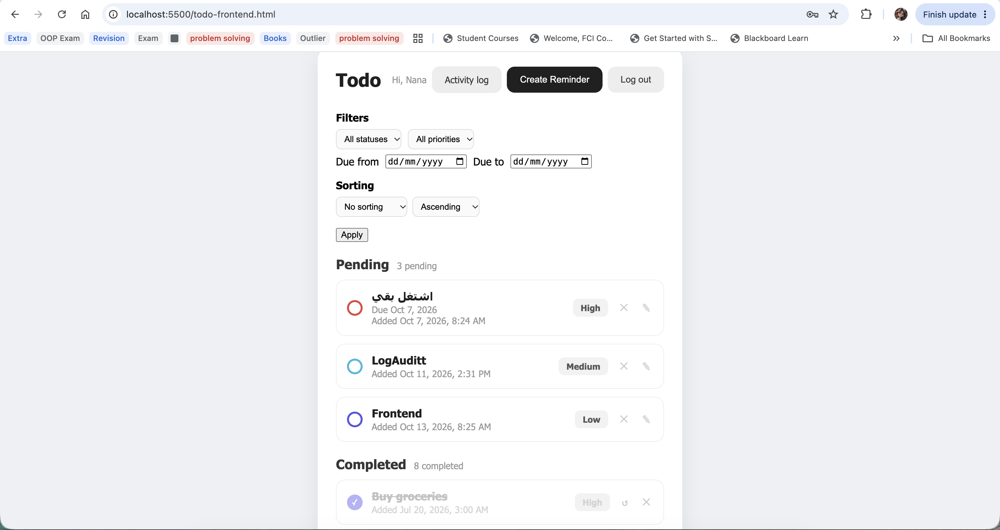
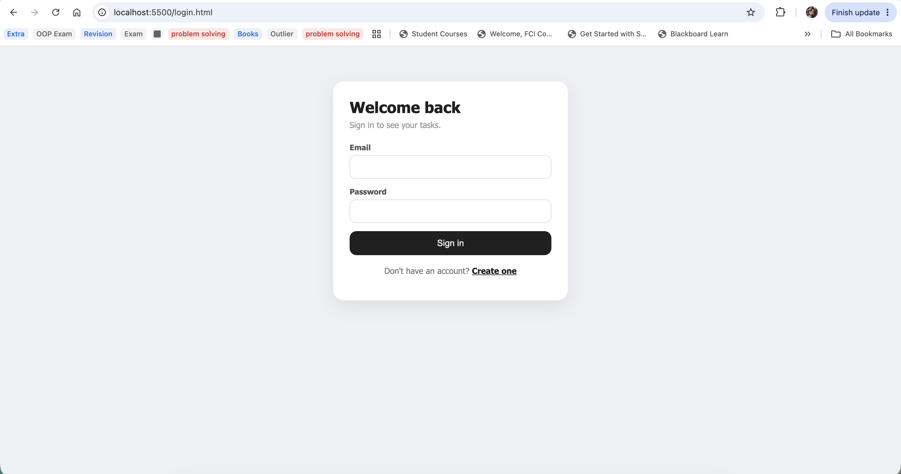
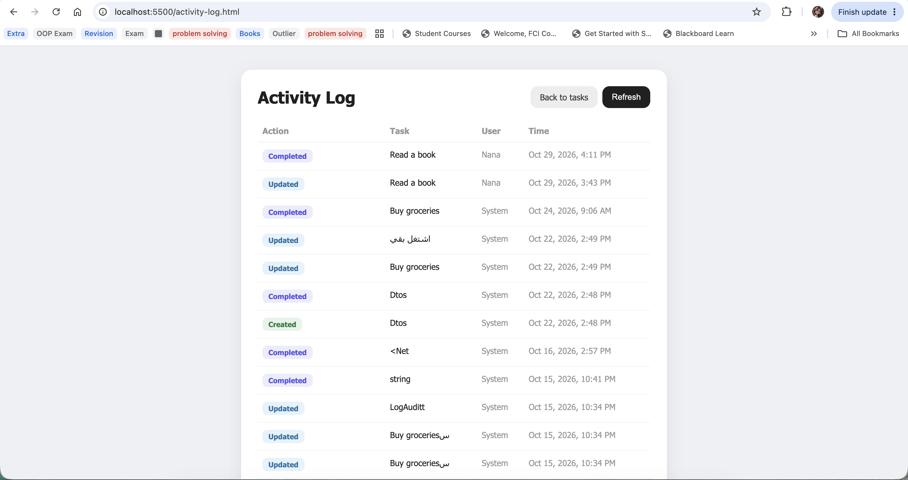

# ToDoApp

A task manager built with **ASP.NET Core 8** and a vanilla JavaScript frontend. Users sign up, log in with a JWT, and manage their tasks: create, edit inline, complete, reopen, filter, and sort. Every change is recorded in an activity log, and completions and upcoming due dates are pushed to the browser in real time with SignalR.



## Features

**Tasks**
- Create, edit (title, priority, due date), delete, complete, and reopen tasks
- Pending and Completed lists with task counts
- Filter by status, priority, and due-date range; sort by title, priority, created date, or due date
- Validation: due dates can't be set in the past, with clear error messages

**Accounts**
- Register and log in with ASP.NET Core Identity
- JWT authentication: every task endpoint requires a valid token
- Password rules: at least 8 characters and one number; duplicate emails are rejected
- Login errors don't reveal whether the email or the password was wrong

**Activity log**
- Every create, update, delete, complete, and reopen is saved with the user who did it
- A separate page lists the full history, newest first

**Real-time notifications (SignalR)**
- A toast appears in every open browser when a task is completed
- A background service sends reminders for tasks due today or tomorrow

**Reliability**
- In-memory caching of the task list, cleared whenever data changes
- Rate limiting: 5 requests per 10 seconds per IP on the API
- One error format for the whole API (validation errors, 401, 404, 500)

## Tech stack

| Layer | Technology |
|---|---|
| API | ASP.NET Core 8 Web API |
| Data | Entity Framework Core 8, SQL Server (Docker) |
| Auth | ASP.NET Core Identity, JWT Bearer |
| Real time | SignalR, `BackgroundService` |
| Tests | xUnit, Moq |
| Frontend | HTML, CSS, vanilla JavaScript |

## Architecture

The solution follows an Onion-style layering. Each layer only depends on the ones inside it:

```
Core/
  DomainLayer               Entities, repository contracts, domain exceptions
  ServiceAbstractionLayer   Service contracts used by the controllers (IToDoService, IAuthService)
  ServiceLayer              Business logic, entity <-> DTO mapping, JWT creation
Infrastructure/
  perisistence              DbContext, migrations, repositories, data seeding
  Presentation              Controllers and the SignalR hub
Shared/                     DTOs, enums, and error response models
ToDoApp/                    Host: Program.cs, middleware, DI setup, background service
Tests/ServiceLayer.Tests    Unit tests for ToDoService
ToDoFrontend/               Login, tasks, and activity log pages
```

Controllers only talk to services through DTOs; services talk to repositories; repositories talk to the database. Business rules (like the due-date check) live in the service layer and are reported as exceptions that a custom middleware turns into the right HTTP response.

## API endpoints

All `/api/ToDo` endpoints require `Authorization: Bearer <token>`.

| Method | Endpoint | Description |
|---|---|---|
| `POST` | `/api/Auth/register` | Create an account, returns a token |
| `POST` | `/api/Auth/login` | Log in, returns a token |
| `GET` | `/api/ToDo` | All tasks |
| `GET` | `/api/ToDo/filter` | Filter and sort (`status`, `priority`, `fromDate`, `toDate`, `sortBy`, `sortDirection`) |
| `GET` | `/api/ToDo/{id}` | One task |
| `POST` | `/api/ToDo` | Create a task |
| `PUT` | `/api/ToDo/{id}` | Update a task |
| `DELETE` | `/api/ToDo/{id}` | Delete a task |
| `PATCH` | `/api/ToDo/{id}/complete` | Mark as completed |
| `PATCH` | `/api/ToDo/{id}/reopen` | Move back to pending |
| `GET` | `/api/ToDo/audit-logs` | Activity log |

SignalR hub: `/notificationHub` (event: `ReceiveNotification`).

## Getting started

### Prerequisites

- [.NET 8 SDK](https://dotnet.microsoft.com/download)
- [Docker](https://www.docker.com/) for SQL Server
- The EF Core CLI: `dotnet tool install --global dotnet-ef`

### 1. Start SQL Server

```bash
docker run -e "ACCEPT_EULA=Y" -e "MSSQL_SA_PASSWORD=<YourStrongPassword>" -p 1433:1433 --name todo-sql -d mcr.microsoft.com/mssql/server:2022-latest
```

### 2. Set the secrets

The connection string and the JWT signing key are kept out of the repository with user secrets:

```bash
dotnet user-secrets set "ConnectionStrings:DefaultConnection" "Server=localhost,1433;Database=ToDoAppDb;User Id=sa;Password=<YourStrongPassword>;TrustServerCertificate=True;MultipleActiveResultSets=true" --project ToDoApp
dotnet user-secrets set "Jwt:Key" "$(openssl rand -base64 48)" --project ToDoApp
```

### 3. Create the database

```bash
dotnet ef database update --project Infrastructure/perisistence --startup-project ToDoApp
```

### 4. Run the API

```bash
cd ToDoApp
dotnet run
```

The API runs on `http://localhost:5093`, with Swagger at `http://localhost:5093/swagger`. Sample tasks are seeded on first run.

### 5. Run the frontend

The API allows requests from `http://localhost:5500`, so serve the frontend on that port:

```bash
cd ToDoFrontend
python3 -m http.server 5500
```

Open `http://localhost:5500/login.html`, create an account, and you're in.

### Run the tests

```bash
dotnet test
```

## Screenshots

| Login | Activity log |
|---|---|
|  |  |

## More

- [How the SignalR notifications were added](Infrastructure/Presentation/Hubs/README.md)
